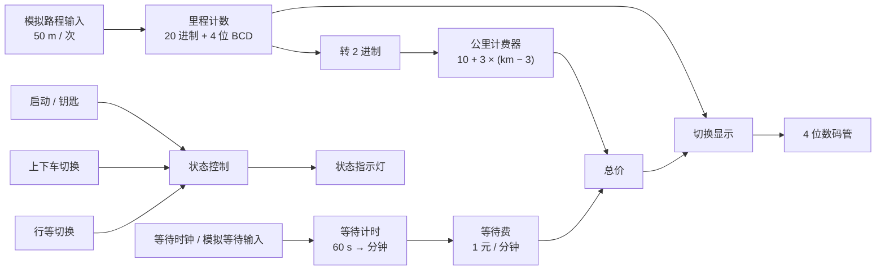

# 出租车计价器设计说明

本文档说明 `src/taxi-meter.circ` 的总体结构、子电路接口、计费原理、操作方法和验证结果。工程使用 **Logisim 2.7.1** 绘制，共包含 10 个子电路。

## 1. 设计目标

在 Logisim 中用纯数字逻辑实现一台出租车计价器：

- 由钥匙开关、乘客上下车开关、行驶/等待开关控制工作状态；
- 用脉冲模拟车轮转动，每个脉冲代表 50 m；
- 4 位数码管显示里程（精确到 1 km）或金额（精确到 1 元）；
- 3 km 以内收起步价 10 元，超出部分每公里加 3 元，不足 1 km 按 1 km 计；
- 等待时每 1 分钟加 1 元，不足 1 分钟按 1 分钟计。

## 2. 需求与实现对照

| 任务书要求 | 实现方式 | 状态 |
| --- | --- | --- |
| 钥匙插入/拔出 | `启动` 引脚作为整机使能 | 已实现 |
| 乘客上/下车 | `上下车切换` 按钮 + D 触发器状态记忆 | 已实现 |
| 行驶/等待 | `行等切换` 按钮 + D 触发器状态记忆 | 已实现 |
| 里程 4 位显示、精确到 1 km | 4 位 BCD 计数器 `9999` + 4 位数码管 | 已实现 |
| 金额 4 位显示、精确到 1 元 | 14 位金额经 `切换显示` 拆成 4 位 BCD | 已实现 |
| 起步价 3 km / 10 元 | 比较器判断 `Km > 3`，否则输出 10 | 已实现 |
| 超出每公里 +3 元 | `(Km − 3) × 3 + 10` | 已实现 |
| 不足 1 km 按 1 km | 剩余 50 m 计数参与计费，补计 1 km | 已实现 |
| 50 m / 脉冲 | 5 位“米计数器”每 20 个脉冲向公里计数器进位 | 已实现 |
| 等待 1 分钟 +1 元 | 60 秒计数器 → 分钟计数器，每个分钟脉冲 +1 元 | 已实现 |
| 不足 1 分钟按 1 分钟 | 剩余秒数判断，结算时补 1 元 | 已实现 |
| 按键消抖 | `毛刺` 子电路（异或边沿检测 + T 触发器） | 已实现 |
| 分时显示 | `分时显示` 产生切换信号，`切换显示` 选择显示源 | 已实现 |

## 3. 总体结构



数据通路可以概括为：

1. **里程通路**：50 m 脉冲 → 5 位米计数器 → 每 20 个脉冲进位 → 4 位 BCD 里程 → 转 2 进制（14 位）。
2. **计费通路**：14 位里程 → 公里计费器 → 里程费；等待计时 → 等待费；两者相加得到总价。
3. **显示通路**：14 位里程和总价送入显示模块，拆成 4 位 BCD，分时轮流送到 4 位数码管。

## 4. 子电路清单

| 子电路 | 功能 | 主要端口 |
| --- | --- | --- |
| `main` | 顶层：连接按键、计数器、计费与显示 | 启动、5 个按钮、4 位数码管、指示灯 |
| `毛刺` | 按键消抖，把一次按下变成一个窄脉冲 | `IN`、`OUT` |
| `74Ls160` | 74LS160 的功能模型：十进制计数、异步清零、同步置数、使能、进位 | `D0–D3`、`CTt`、`CTp`、`CLK`、`CRn`、`LDn`、`Q0–Q3`、`CO` |
| `99计数器` | 2 位 BCD 计数器（00–99） | `DA/DB`、`QA/QB`、`CLK`、`CRn`、`LDn`、`CTt/CTp`、`RES`、`CO` |
| `999` | 3 位 BCD 计数器（000–999） | `DA–DC`、`QA–QC`、`CLK`、`CRn`、`LDn`、`CTt/CTp`、`RES`、`CO` |
| `9999` | 4 位 BCD 计数器（0000–9999），顶层用作里程计数器 | `DA–DD`、`QA–QD`、`CLK`、`CRn`、`LDn`、`CTt/CTp`、`RES`、`CO` |
| `转2进制` | 4 位 BCD（千/百/十/个）→ 14 位二进制 | `千位`、`百位`、`十位`、`个位`、`进位`、`out` |
| `公里计费器` | 由里程计算里程费 | `Km`（14 位）、`Money`（14 位） |
| `切换显示` | 把 14 位金额/里程拆成 4 位 BCD，并选择显示源 | `金额`、`Km数`、`使能`、`分时CLK`、`千/百/十/个`、`显示Km`、`显示Money` |
| `分时显示` | 产生分时切换信号，控制里程/金额轮流显示 | `Km数`、`金额`、`重置`、`分时CLK`、`分时输出`、`显示Km`、`显示Money` |

> `99计数器` 和 `999` 在顶层未直接使用，保留下来便于扩展显示位数或复用到其他计数场景。

## 5. 模块实现

### 5.1 按键输入与消抖

机械按键在按下和松开时会产生抖动。如果直接把按钮信号送进计数器，一次按下可能被记成多次。

`毛刺` 子电路由两个异或门和一个 T 触发器组成：

- 异或门比较“当前按键电平”和“触发器保存的上一状态”；
- 两者不同时产生一个窄脉冲；
- T 触发器在脉冲边沿翻转，记住新的按键状态。

这样每次按键（按下或松开）只产生一个脉冲，后面的 D 触发器据此翻转乘客状态或行驶状态，计数器和计时器不会重复触发。

### 5.2 状态控制

顶层用两枚 D 触发器分别记忆两个状态：

| 状态 | 控制信号 | 表现 |
| --- | --- | --- |
| 乘客是否在车上 | `上下车切换` 按钮 | 载客指示灯亮，计费与显示使能 |
| 行驶还是等待 | `行等切换` 按钮 | 行驶灯亮时按里程计费；等待灯亮时按时间计费 |

`启动` 引脚相当于车钥匙：置 1 后整机使能；置 0 时整机停止工作。电路中还保留了 `清除上一位乘客数据` 信号，用于开始新行程时清除上一位乘客的里程、金额和等待时间。

### 5.3 里程计量

1. 每按一次 `模拟路程输入`，产生一个 50 m 脉冲。
2. 5 位“米计数器”对脉冲计数，计到 20（即 20 × 50 m = 1 km）时产生进位并回到 0。
3. 进位送进 4 位 BCD 计数器 `9999`，使公里数加 1；`9999` 由 4 个 `74Ls160` 级联而成，输出千、百、十、个四位 BCD。
4. `转2进制` 把 4 位 BCD 按 `千×1000 + 百×100 + 十×10 + 个` 转成 14 位二进制，供后面的比较、减法和乘法使用。

里程显示范围为 0000–9999 km。

### 5.4 里程计费

`公里计费器` 是纯组合逻辑：

```text
if Km <= 3:  Money = 10
else:        Money = 10 + (Km - 3) × 3
```

电路组成：

- **比较器**：判断 `Km > 3`，同时产生选择信号；
- **减法器**：计算 `Km − 3`；
- **乘法器**：计算 `(Km − 3) × 3`；
- **加法器**：加上起步价 10；
- **受控缓冲/选择器**：`Km ≤ 3` 时直接输出 10，`Km > 3` 时输出计算结果。

不足 1 km 的处理：米计数器还保存着“剩余 50 m 数”，当其不为 0 时，计费逻辑会补计 1 km，因此 3.2 km 会按 4 km 收费（13 元），而不是 10 元。

### 5.5 等待计费

等待模块包含两级计数：

1. **秒计数器**：对等待时钟计数，计到 59 后回到 0，同时向分钟计数器进位（60 秒 = 1 分钟）。
2. **分钟计数器**：每收到一次秒进位就加 1，相当于每分钟加 1 元。

“不足 1 分钟按 1 分钟计”由剩余秒数判断实现：结算时如果秒计数器不为 0，就再补 1 元。

总价：

```text
总价 = 里程费 + 等待分钟数 + （有剩余秒数 ? 1 : 0）
```

等待计时既可以由电路中的等待时钟自动推进，也可以用 `模拟等待输入` 按钮手动打点，方便快速演示。

### 5.6 显示

显示模块要解决两个问题：把 14 位二进制数拆成 4 位十进制，以及在里程和金额之间切换。

- **拆位**：`切换显示` 用除以 1000、100、10 的除法器和余数，依次得到千位、百位、十位、个位，每个都是一位 BCD。
- **选择**：`切换显示` 根据 `显示Km` / `显示Money` 信号，在“里程的 4 位”和“金额的 4 位”之间选择。
- **分时**：`分时显示` 内部的移位寄存器在 `分时CLK` 驱动下循环产生两组选通信号，使 4 位数码管在一段时间内显示里程、下一段时间显示金额；对应的 `显示Km` / `显示Money` 指示灯同步点亮。
- **调试**：顶层还保留了一个灰色背景的调试数码管，显示 `分时输出`（当前被选中的那一位数字），方便观察分时逻辑。

切换周期由 `分时CLK` 决定：显示内容会在里程和金额之间交替，旁边的指示灯用于区分当前显示的是哪一个。

## 6. 计费算例

| 场景 | 计算 | 金额 |
| --- | --- | --- |
| 0–3 km | 起步价 | 10 元 |
| 4 km | 10 + 1 × 3 | 13 元 |
| 5 km | 10 + 2 × 3 | 16 元 |
| 10 km | 10 + 7 × 3 | 31 元 |
| 20 km | 10 + 17 × 3 | 61 元 |
| 3 km + 等待 2 分钟 | 10 + 2 | 12 元 |
| 3.2 km | 按 4 km 计 | 13 元 |

## 7. 操作步骤

1. 打开工程，确认仿真已启用（`Simulation → Simulation Enabled`）。
2. 点击 `reset`，让所有计数器和触发器回到初始状态。
3. 将 `启动` 置 1，表示插入钥匙。
4. 按一次 `上下车切换`，乘客上车，载客指示灯亮。
5. 按一次 `行等切换`，进入行驶状态。
6. 点击 `模拟路程输入`：每 20 次里程加 1 km。可以观察 4 位数码管在里程与金额之间轮换。
7. 需要等待计费时，按 `行等切换` 切到等待；等待满 1 分钟金额加 1 元。可用 `模拟等待输入` 手动打点。
8. 到达后按 `上下车切换` 让乘客下车，记录金额。
9. 按 `reset` 清除数据，开始下一趟。

## 8. 验证

### 8.1 里程计费

对 `公里计费器` 子电路逐点仿真（Km = 0…30），结果如下：

| Km | 0 | 1 | 2 | 3 | 4 | 5 | 6 | 7 | 8 | 9 | 10 |
| --- | --- | --- | --- | --- | --- | --- | --- | --- | --- | --- | --- |
| Money | 10 | 10 | 10 | 10 | 13 | 16 | 19 | 22 | 25 | 28 | 31 |

| Km | 15 | 20 | 25 | 30 |
| --- | --- | --- | --- | --- |
| Money | 46 | 61 | 76 | 91 |

结果与 `10 + 3 × (Km − 3)` 完全一致。

### 8.2 显示拆位

对 `切换显示` 子电路输入金额 1234，千位、百位、十位、个位分别输出 1、2、3、4，说明 BCD 拆位和 4 位显示格式正确。

### 8.3 整机测试建议

| 测试项 | 操作 | 预期 |
| --- | --- | --- |
| 复位 | 按 `reset` | 显示 0000 |
| 起步价 | 行驶 3 km | 金额 0010 |
| 超起步价 | 行驶 4 km | 金额 0013 |
| 不足 1 km | 行驶 3.2 km | 金额 0013 |
| 等待费 | 行驶 3 km + 等待 1 分钟 | 金额 0011 |
| 等待不足 1 分钟 | 等待几十秒后结算 | 金额加 1 |
| 长里程 | 行驶 10 km | 金额 0031 |

> 表中起步价、超起步价两项已由 `公里计费器` 子电路仿真确认；其余为按计费规则推导的整机预期值，建议在 Logisim 中按第 7 节步骤复现。

## 9. 设计取舍与已知问题

1. **4 位显示上限**：里程和金额都只有 4 位，最大 9999。金额超过 9999 元时显示会溢出；实际在 9999 km 时金额远超此值。
2. **费率固化**：阈值 3、单价 3、起步价 10、等待单价 1 都是电路中的常量。修改费率要改 `公里计费器` 和等待模块中的常量，并重新检查位宽。
3. **距离分辨率**：最小 50 m，且需要手动点击脉冲；没有连续测距输入。
4. **显示轮换**：里程与金额共用 4 位数码管，靠指示灯区分；如果希望同时显示，需要增加一组数码管。
5. **理想仿真**：Logisim 不模拟门延迟、竞争冒险和真实按键抖动；`毛刺` 只是逻辑层面的单次触发。
6. **未使用的子电路**：`99计数器`、`999` 为扩展预留，不参与顶层功能。

## 10. 可扩展方向

- 用 ROM/RAM 存放费率参数，实现多城市、多时段费率切换；
- 增加数码管或 LCD，同时显示里程、金额、等待时间；
- 增加 EEPROM 保存行程记录，或增加 UART 接口连接打印机；
- 把设计改写为 Verilog/VHDL，在 FPGA 上做时序验证；
- 增加夜间费、返空费、低速行驶费等更复杂的计费规则。

## 11. 文件与版本

| 文件 | 说明 |
| --- | --- |
| `src/taxi-meter.circ` | Logisim 2.7.1 工程，主电路为 `main` |
| `README.md` | 项目简介、功能、操作与快速开始 |
| `docs/DESIGN.md` | 本设计说明 |

版本说明：原始工程中的 `毛刺` 实例引用了一个外部库文件（`… test.circ`），该文件未随工程分发。本仓库版本已将该引用改为工程内同名子电路 `毛刺`，工程可以独立打开，不依赖任何外部文件。
